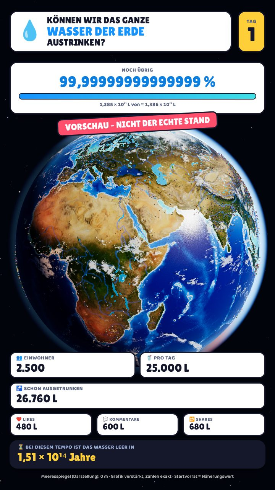
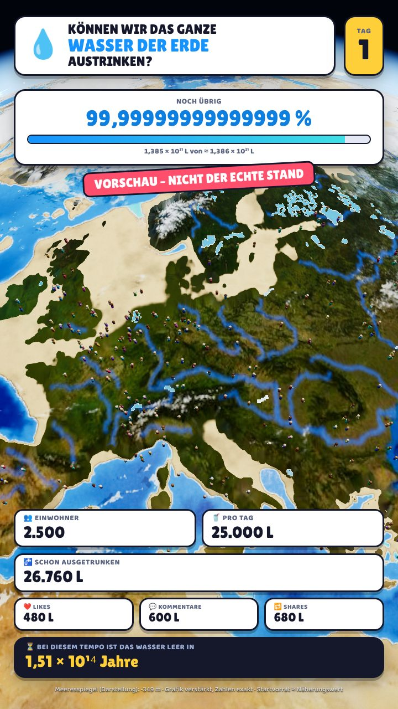
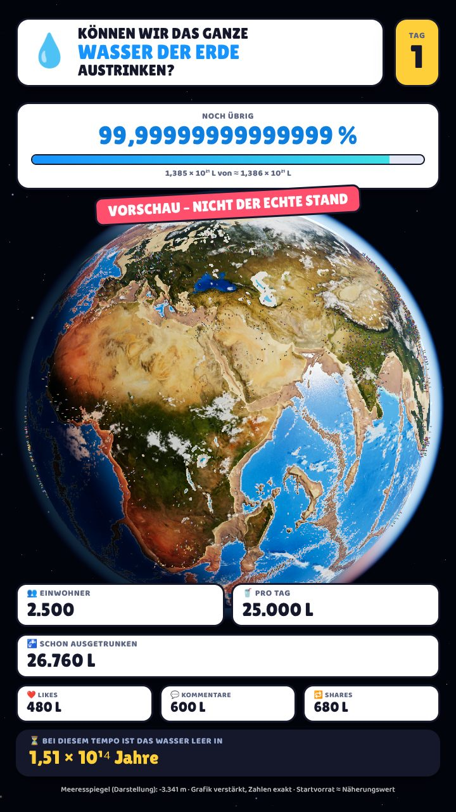
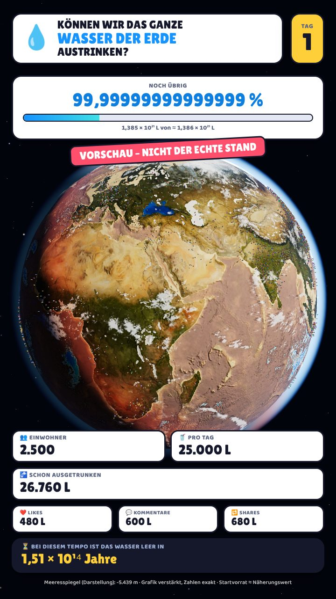

# 🌍💧 Können wir das gesamte Wasser der Erde austrinken?

Langfristiges TikTok-Experiment: Jeder Follower bringt einen Menschen auf die **echte Erde**.
Jeder Mensch trinkt **10 Liter pro Tag** – Likes, Kommentare und Shares kosten zusätzlich Wasser.
Wie lange dauert es, bis die Erde trocken ist?

| Heute | Europa (8 % ausgetrocknet) | 30 % | 92 % |
|---|---|---|---|
|  |  |  |  |

*(Vorschaubilder mit dem Vorschau-Regler erzeugt – nicht der echte Stand.)*

---

## 🚀 Schnellstart (für Anfänger)

Du brauchst **Node.js 22.18 oder neuer** (https://nodejs.org).

```bash
npm install          # einmalig: Bibliotheken herunterladen
npm run dev          # startet die App -> im Browser http://localhost:5173 öffnen
```

Links siehst du das 9:16-Video-Bild, rechts das Bedienfeld.

### Zahlen eintragen
Im Bedienfeld (oder im Terminal):

```bash
# Startdatum der Simulation festlegen (nur einmal, bevor es Einträge gibt)
npm run sim -- init --start 2026-11-12

# Variante A: NEUE Zahlen seit der letzten Eingabe
npm run sim -- add --followers 120 --likes 3400 --comments 56 --shares 12 --ref video-01

# Variante B: GESAMTSTAND aus der TikTok-App abschreiben (das Programm rechnet die Differenz aus)
npm run sim -- totals --followers 1520 --likes 48000 --comments 900 --shares 300 --ref video-02

npm run sim -- status   # aktuellen Stand anzeigen (verbucht alle Tage bis heute)
npm run sim -- undo     # letzten Eintrag löschen
```

> **Tipp:** Variante B ist am sichersten – du kannst nichts doppelt zählen.
> `--ref` (z. B. `video-07`) verhindert, dass dasselbe Video zweimal eingetragen wird.

> ⚠️ Es gibt **keine** Live-Verbindung zu TikTok. Alle Zahlen gibst du selbst ein.

### 💾 Dein Spielstand
Alles steht in **`data/simulation.json`** (wird beim ersten Start angelegt).
**Diese Datei ist dein Spielstand – sichere sie regelmäßig** (z. B. mit `git add data/simulation.json && git commit`).
Vor jeder Änderung legt das Programm automatisch eine Kopie in `data/backups/` ab (die letzten 30).

---

## 📐 Die Regeln (exakt umgesetzt)

| Aktion | Wasser |
|---|---|
| 1 neuer Follower | 1 neuer Mensch, trinkt an jedem Tag (Start: **10 L**, siehe Meilensteine) |
| 1 Like | **einmalig** 10 ml (+ Meilensteine) |
| 1 Kommentar | **einmalig** 500 ml (+ Meilensteine) |
| 1 Share | **einmalig** 2 L (+ Meilensteine) |
| Startvorrat | **≈ 1,386 Mrd. km³ = 1,386 × 10²¹ L** (Näherungswert, Salz- + Süßwasser) |

### ⚡ Meilensteine – der Durst wächst mit der Community
Die Verbrauchswerte hängen von der **gesamten erreichten Followerzahl** ab und steigen dauerhaft:

| Regel | Formel | Beispiele |
|---|---|---|
| Like | 10 ml + (Anzahl 100er-Meilensteine) × 100 ml | 99 F.: 10 ml · 100 F.: 110 ml · 1.000 F.: 1.010 ml |
| Kommentar | 0,5 L + (Anzahl 250er-Meilensteine) × 1 L | 250 F.: 1,5 L · 1.000 F.: 4,5 L |
| Share | 2 L + (Anzahl 500er-Meilensteine) × 4 L | 500 F.: 6 L · 2.000 F.: 18 L |
| Trinken pro Einwohner/Tag | 10 L × 2 hoch (Anzahl 1.000er-Meilensteine), **höchstens 10 Verdopplungen** | 1.000 F.: 20 L · 5.000 F.: 320 L · **ab 10.000 F.: 10.240 L (Maximum)** |

- Neue Meilensteine gelten **sofort** (auch für die Likes/Kommentare/Shares und neuen Menschen desselben Eintrags);
  alle Einwohner trinken ab dem nächsten Tag mit der neuen Menge.
- **Bereits verbrauchtes Wasser wird nie nachträglich verändert** (Tage werden mit der Stufe verbucht, die an dem Tag galt).
- Spielstände von vor dieser Regel werden automatisch umgestellt: Die Meilensteine gelten ab dem Tag nach dem letzten verbuchten Tag.
- Rechnung mit BigInt → exakt auch bei riesigen Werten (z. B. 2 hoch 1.000).
- Ab 10.000 Followern gibt es keine weiteren Verdopplungen: Jeder (auch jeder neue) Einwohner trinkt 10.240 L pro Tag,
  die Einwohnerzahl wächst aber unbegrenzt weiter.
- Spannend: Selbst wenn alle 8 Milliarden Menschen folgen würden, reicht das Wasser noch rund **46.353 Jahre**.

**Festgelegte Details** (lassen sich ändern, falls du es anders willst):
- Ein **Tag** ist ein Kalendertag in **Europe/Berlin** (Mitternacht deutscher Zeit).
- Ein neuer Mensch trinkt schon an seinem **Ankunftstag**.
- Likes/Kommentare/Shares zählen **einmal** (nicht jeden Tag erneut).
- Entfolgt jemand, verschwindet der Mensch **nicht** (im Gesamtstand-Modus wird nach einem Rückgang erst wieder gezählt, wenn der alte Höchststand überschritten ist).

**Warum nichts doppelt gezählt wird:** Gespeichert wird ein *Logbuch* aller Eingaben. Der Stand wird jedes Mal
komplett aus dem Logbuch neu berechnet (Tag für Tag, mathematisch zusammengefasst). Egal wie oft du das Programm
startest – jeder Tag wird genau einmal verbucht, auch wenn wochenlang kein Video kommt.

**Genauigkeit:** Alle Wassermengen werden in **Millilitern als `BigInt`** (ganze Zahlen ohne Größengrenze) gerechnet.
1,386 × 10²⁴ ml passen exakt hinein – es gibt keine Rundungsfehler.

---

## 👁️ Visuelle Skalierung (wichtig!)

1 Million Liter sind nur 0,00000000000007 % des Erdwassers – echt dargestellt sähe man **nichts**.
Deshalb ist die **Grafik verstärkt**, die **Zahlen bleiben exakt**:

1. **Logarithmische Skala:** Jede Verzehnfachung des Verbrauchs (ab 10.000 L) lässt die Erde um einen gleich
   großen Schritt austrocknen. Bei 100 % Verbrauch ist die Erde auch optisch komplett trocken.
2. Dieser Wert bestimmt, **welcher Anteil der Meeresfläche trockenfällt**. Der passende Meeresspiegel wird aus
   **echten Höhen- und Tiefendaten (ETOPO1)** berechnet – deshalb fallen zuerst die flachen Schelfmeere trocken
   (Nordsee, Beringstraße, Indonesien), später die Tiefsee-Becken und zuletzt die Tiefseegräben.
3. Seen schrumpfen vom Ufer her, Flüsse versiegen, grüne Flächen werden zunehmend wüstenartig.

Im HUD steht immer „Grafik verstärkt, Zahlen exakt“. Im Bedienfeld kannst du auf „Echt (unverstärkt)“ umschalten.

---

---

## 🎬 TikTok-Videos erstellen

Die Videos sind im Stil von Erklär-Cartoons aufgebaut: Sprecherstimme, Untertitel mit 1–3 Wörtern
(Schlüsselwörter farbig), schnelle Schnitte, Sticker, hochzählende Zahlen und unser Moderator **Kapitän Durst**.

### 1. Drehbuch schreiben
Jede Folge ist eine Datei in **`folgen/`** (Beispiel: `folgen/folge-01.json`). Pro Satz ein „Beat“:

```json
{ "text": "Gerade leben hier {gruen:{einwohner}} Menschen.",
  "kamera": "asia",
  "sticker": [{ "typ": "zahl", "label": "EINWOHNER", "von": 0, "bis": "{einwohner}", "farbe": "gruen" }] }
```

- **Hervorheben:** `*Wort*` = gelb, `{gruen:Wort}`, `{rot:Wort}`, `{blau:Wort}`
- **Echte Zahlen** (werden automatisch eingesetzt): `{tag}` `{einwohner}` `{follower}` `{neue_follower}` `{pro_tag}`
  `{pro_tag_zahl}` `{verbraucht}` `{verbraucht_zahl}` `{likes}` `{kommentare}` `{shares}` `{reicht}` `{reicht_kurz}`
- **Kamera:** `kapitaen` (Moderator im Bild), `space`, `orbit`, `europe`, `africa`, `asia`, `americas`, `australia`,
  `northsea`, `sunda`, `pacific`, `flyover`, `bering`
- **Sticker:** `tag`, `schild`, `zahl`, `info`, `zeiger` (zeigt auf einen Ort), `namensschild`, `profil`, `statistik`
- **Weitere Felder:** `"strohhalm": true`, `"aktion": "winken" | "trinken"`, `"wasser": { "von": "jetzt", "bis": 0.5 }`
  (Vorschau, wird als VORSCHAU gekennzeichnet), `"min": 2.5` (Mindestdauer), `"audio": "aufnahmen/satz-03.mp3"`

### 2. Ansehen (ohne Ton)
`npm run dev` → im Bedienfeld unter „Folge abspielen“ die Folge auswählen → ▶

### 3. Video rendern
```bash
npm run video -- --folge folge-01            # echte Zahlen
npm run video -- --folge folge-01 --demo     # Probevideo mit Beispielzahlen
```
Ergebnis: `output/folge-01.mp4` (1080×1920, 30 fps) + `output/folge-01.srt` (Untertitel).
Optionen: `--musik musik.mp3` (leise im Hintergrund), `--seit 2026-11-12` (für `{neue_follower}`),
`--hoehe 1280 --fps 24` (kleiner/schneller), `--leicht` (schneller auf Rechnern ohne gute Grafikkarte), `--bis 5` (nur 5 Sekunden testen).

### 🎙️ Stimme
**Standard: natürliche deutsche KI-Stimme „Thorsten“** (Piper, läuft offline, Lizenz CC0 – auch für TikTok erlaubt).
Einmalig einrichten: `npm run stimme-laden` (lädt die Stimme ~110 MB und installiert Piper).
Im Drehbuch: `"stimme": { "typ": "piper", "tempo": 0.93 }` (kleiner = schneller).

Wenn eine Zahl falsch ausgesprochen wird, im Beat `"sprache": "..."` mit ausgeschriebenem Text angeben.

### 🎵 Musik und Soundeffekte
Werden automatisch erzeugt (eigene Kompositionen, keine Lizenzprobleme):
- `"musik": "ruhig" | "treibend" | "drama"` ab einem Beat
- Effekte kommen automatisch: Whoosh bei Kamerafahrten, Plopp bei Schildern, Ticken + „Ding“ bei Zahlen,
  Schluckgeräusch bei Menschen-Nahaufnahmen, Tropfen bei Szenarien; zusätzlich per `"effekte": [{ "t": 0.2, "typ": "riser" }]`
  (Typen: pop, whoosh, tick, ding, gulp, impact, riser, drop)
- Die Musik wird automatisch leiser, wenn gesprochen wird; Gesamtlautstärke auf TikTok-Niveau (-14 LUFS).
- Eigene Musik: `--musik datei.mp3`

### 🌍 Neue Drehbuch-Möglichkeiten (Version 2)
- `"szenario": { "einwohner": 1000000, "tage": 365 }` + Sticker `{ "typ": "szenario" }`: „Was wäre, wenn …“ –
  gerechnet mit den echten Regeln (10 L pro Mensch und Tag); der Wasserstand im Bild passt genau dazu.
- `"einwohner_vorschau": 2000` + Kamera `"gruppe"`: Dorf mit Menschengruppe (wird als VORSCHAU gekennzeichnet)
- Sticker `{ "typ": "zahlen" }`: große Zahlenkacheln mit allen Werten; `{ "typ": "titel", "zeilen": [...] }`: große Überschrift
- `"untertitel": false`: Untertitel für diesen Beat ausblenden
- Kameras: `intro`, `zoom`, `ozean`, `europa`, `einwohner1`, `gruppe`, `rueckflug`, `finale` (+ alle bisherigen)

### 🎙️ Deine eigene Stimme (optional)
**So geht's:**
1. Text anzeigen lassen: `npm run sprechertext -- --folge folge-01`
2. Mit dem Handy (Sprachmemo) **alles am Stück** einsprechen.
   **Nach jeder nummerierten Zeile ca. 1 Sekunde Pause machen** – daran erkennt das Programm die Sätze.
3. Datei z. B. als `folgen/aufnahmen/folge-01.m4a` speichern und rendern:
   ```bash
   npm run video -- --folge folge-01 --aufnahme folgen/aufnahmen/folge-01.m4a
   ```
   oder dauerhaft im Drehbuch eintragen: `"stimme": { "typ": "aufnahme", "datei": "aufnahmen/folge-01.m4a" }`

Das Programm schneidet die Aufnahme an den Pausen, gleicht die Lautstärke an, und das Video
(Kamera, Sticker, Untertitel) passt sich automatisch an dein Sprechtempo an.
Alternativ geht auch eine Datei pro Satz (`"audio": "aufnahmen/satz-03.mp3"` im jeweiligen Beat)
oder eine KI-Stimme (z. B. CapCut/ElevenLabs), die du genauso als Datei einträgst.

Die alte Computer-Teststimme (`"typ": "espeak"`) braucht: `sudo apt install espeak-ng mbrola mbrola-de6`.

## 🧱 Projektstruktur

```
src/sim/            Rechenkern (ohne Grafik, getestet)
  config.ts         alle Regeln & Startvorrat
  simulation.ts     Logbuch -> Stand (Tage, Einwohner, Verbrauch)
  days.ts           Kalendertage in fester Zeitzone
  format.ts         deutsche Zahlenanzeige (1,386 × 10²¹ L)
  visualScale.ts    Verstärkung für die Grafik + Meeresspiegel
src/earth/          3D-Erde mit Three.js
  earthMaterial.ts  Shader: Land, Wasser, Meeresboden, Licht
  sky.ts            Wolken, Atmosphäre, Sterne, Sonne
  people.ts         Menschen (Instancing, bis 4.000 Figuren)
  mascot.ts         Kapitän Durst + Riesen-Strohhalm
  camera.ts         Kamera-Shots & Kamerafahrten
  scene.ts          alles zusammen
src/ui/             HUD (im Video) und Bedienfeld
server/             Speicherung (store.ts) + kleine Web-Schnittstelle
scripts/sim.ts      Terminal-Werkzeug
scripts/screenshot.ts  Vorschaubild 9:16 rendern
scripts/render-video.ts  fertiges TikTok-Video (MP4) rendern
folgen/             Drehbücher der Folgen
src/video/          Zeitleiste, Untertitel, Sticker-Abspieler
tests/              automatische Tests (npm test)
tools/prepare_assets.py  erzeugt public/assets aus Rohdaten (nur nötig, wenn man die Karten neu bauen will)
public/assets/      fertige Erd-Daten (Höhen, Masken, Texturen, Städte)
```

## 🧪 Tests
```bash
npm test          # 42 Tests: Regeln, mehrere Tage, Speicherung, Doppelzählung, große Zahlen …
npm run typecheck
```

## 📸 Vorschaubild rendern
```bash
npm run dev                                   # in einem Terminal
npm run screenshot -- --shot europe --out output/europa.png            # echter Stand
npm run screenshot -- --shot space --drain 0.3 --out output/test.png   # Vorschau 30 %
```
Shots: `space`, `orbit`, `europe`, `africa`, `asia`, `americas`, `australia`, `northsea`, `sunda`, `pacific`, `flyover`, `bering`.

## 🗺️ Datenquellen (frei nutzbar)
- Höhen & Meerestiefen: **NOAA ETOPO1** (10-Bogenminuten-Version über pyvista/vtk-data) – ergibt 1,333 Mrd. km³ Ozeanvolumen
- Erdfarben: **NASA Blue Marble**, Wolken & Nachtlichter: NASA-Bilder (über three-globe / three.js)
- Seen, Flüsse, Städte: **Natural Earth**

Weitere Planung: siehe [docs/ENTWICKLUNGSPLAN.md](docs/ENTWICKLUNGSPLAN.md).
